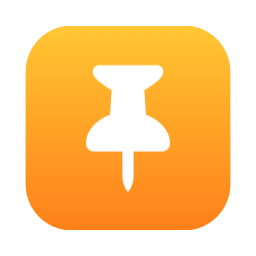
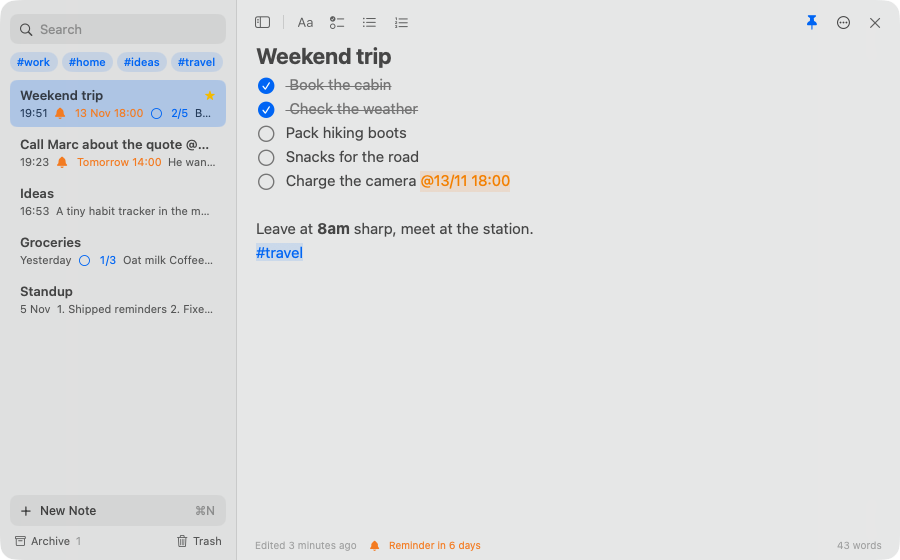
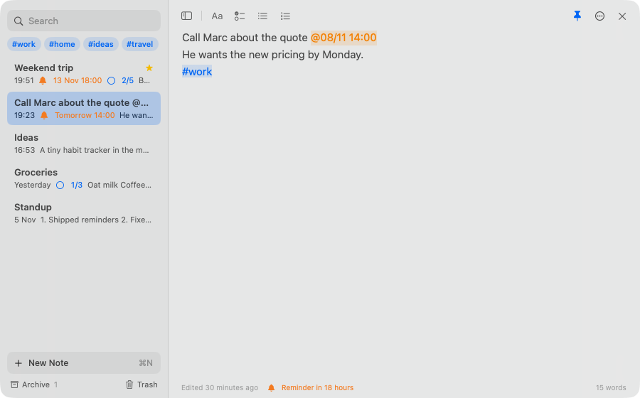
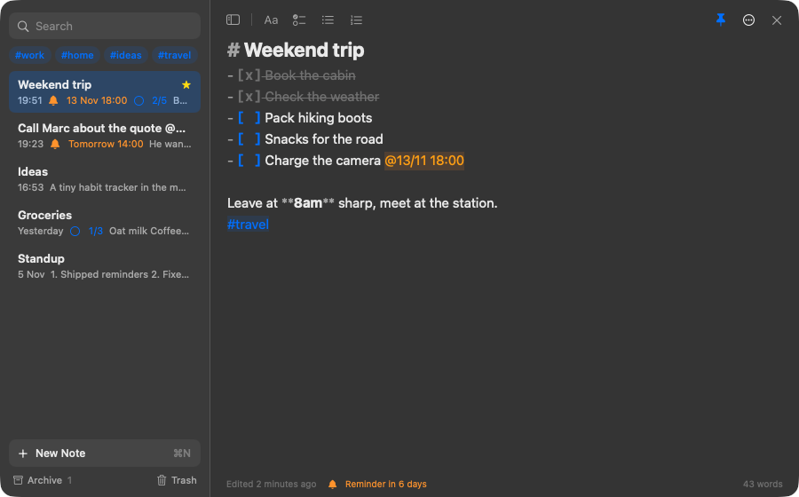
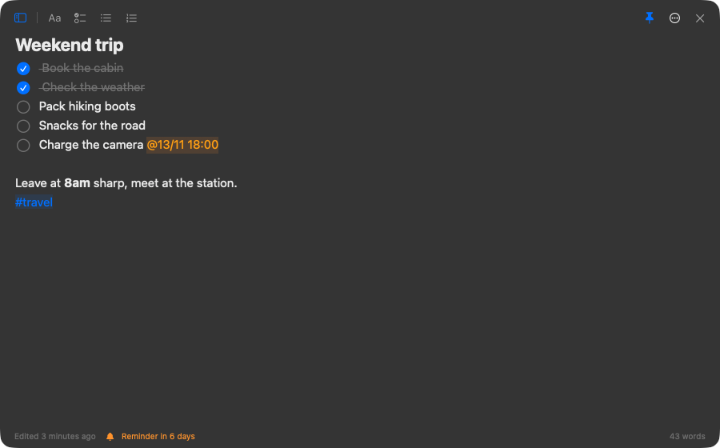
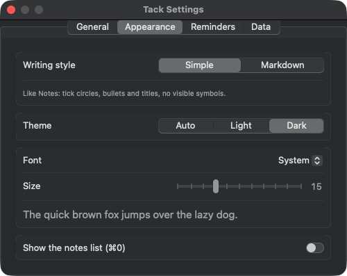

<div align="center">



# Tack

<h3>A quick alternative to Notes.</h3>

**Pin a thought before it's gone.** Press <kbd>⌃</kbd> <kbd>⌥</kbd> <kbd>N</kbd> anywhere (even over a full-screen app), type, press <kbd>Esc</kbd>. Done.
Checklists, reminders, tags and Markdown in a tiny native menu bar app for macOS. Free, open source, and nothing leaves your Mac.

[](https://github.com/ryolay/tack/actions/workflows/ci.yml)
[](https://github.com/ryolay/tack/releases/latest)
[](LICENSE)


[](.swiftlint.yml)


[](CONTRIBUTING.md)

<br>

<picture>
  <source media="(prefers-color-scheme: dark)" srcset="docs/dark.png">
  
</picture>

<br>

[**Download Tack 0.1.0**](https://github.com/ryolay/tack/releases/latest) · [Features](#-features) · [Shortcuts](#%EF%B8%8F-keyboard-shortcuts) · [Build from source](#-build-from-source)

</div>

---

## ✨ Why Tack?

Opening a full notes app to jot down one line breaks your flow, and it's even worse when you're in a full-screen app. Tack lives in the menu bar and opens a floating panel **on top of whatever you're doing**, on the Space you're already on.

<table>
<tr>
<td width="33%" valign="top">

### ⚡ Instant

One shortcut from anywhere. The cursor is already in a fresh note. <kbd>Esc</kbd> closes it and everything is saved.

</td>
<td width="33%" valign="top">

### ✅ Dead simple

Tick circles, bullets and titles, like Notes, with a tiny toolbar. Prefer Markdown? Switch the writing style.

</td>
<td width="33%" valign="top">

### 🔒 Private

No account, no cloud, no analytics. One JSON file on your Mac, backed up at every launch.

</td>
</tr>
</table>

## 📸 Screenshots

<table>
<tr>
<td width="50%"><p align="center"><sub><b>Reminders in plain language</b>: <code>@tomorrow 2pm</code> becomes a notification</sub></p></td>
<td width="50%"><p align="center"><sub><b>Markdown style</b>: live formatting with the syntax kept visible</sub></p></td>
</tr>
<tr>
<td width="50%"><p align="center"><sub><b>Focus mode</b>: hide the list with <kbd>⌘</kbd> <kbd>0</kbd></sub></p></td>
<td width="50%"><p align="center"><sub><b>Settings</b>: shortcut, language, theme, font, reminders, export</sub></p></td>
</tr>
</table>

## 🧰 Features

| | |
| --- | --- |
| 🪟 **Over everything** | Floating panel that shows over full-screen apps and on every Space, without switching away |
| ⌨️ **Global shortcut** | <kbd>⌃</kbd> <kbd>⌥</kbd> <kbd>N</kbd> by default, change it in Settings. No Accessibility permission needed |
| ✅ **Checklists** | Click a circle to tick it; <kbd>↩</kbd> continues the list, <kbd>↩</kbd> on an empty item ends it |
| ✍️ **Two writing styles** | **Simple** (like Notes, formatting toolbar, no symbols) or **Markdown** (live styling, syntax visible) |
| 🔔 **Reminders** | Write `@tomorrow 2pm`, `@friday`, `@in 30min`, `@25/12 10:00` (or in French: `@demain 14h`) and get a macOS notification |
| 🏷️ **Tags** | Add `#work` anywhere in a note, filter with one click |
| ⭐ **Organize** | Favorites on top, archive, Trash kept 30 days, undo after deleting |
| 🔍 **Search** | Across every note, accent and case insensitive, with <kbd>↑</kbd> <kbd>↓</kbd> <kbd>↩</kbd> to jump in |
| 📌 **Keep on top** | Pin the panel to keep a checklist in sight while you work |
| 🎨 **Make it yours** | Light or dark theme, system, serif, rounded or mono font, 12 to 22 pt |
| 🌍 **English and French** | Follows your system language, or pick one in Settings |
| 📤 **Export** | Every note as a Markdown file, in one click |

## ⌨️ Keyboard shortcuts

| Shortcut | Action | Shortcut | Action |
| --- | --- | --- | --- |
| <kbd>⌃</kbd> <kbd>⌥</kbd> <kbd>N</kbd> | Open / close Tack (global) | <kbd>⌘</kbd> <kbd>N</kbd> | New note |
| <kbd>⌘</kbd> <kbd>F</kbd> | Search | <kbd>⌘</kbd> <kbd>1</kbd> … <kbd>9</kbd> | Jump to a note |
| <kbd>⌥</kbd> <kbd>⌘</kbd> <kbd>↑</kbd> <kbd>↓</kbd> | Previous / next note | <kbd>⌘</kbd> <kbd>0</kbd> | Show / hide the list |
| <kbd>⇧</kbd> <kbd>⌘</kbd> <kbd>L</kbd> | Checklist | <kbd>⌘</kbd> <kbd>B</kbd> / <kbd>⌘</kbd> <kbd>I</kbd> | Bold / italic |
| <kbd>⇧</kbd> <kbd>⌘</kbd> <kbd>P</kbd> | Favorite | <kbd>⇧</kbd> <kbd>⌘</kbd> <kbd>A</kbd> | Archive |
| <kbd>⇧</kbd> <kbd>⌘</kbd> <kbd>⌫</kbd> | Move to Trash | <kbd>⇧</kbd> <kbd>⌘</kbd> <kbd>K</kbd> | Keep the panel on top |
| <kbd>⌘</kbd> <kbd>,</kbd> | Settings | <kbd>Esc</kbd> | Close |

## 📥 Install

1. Download `Tack-x.y.z.zip` from the [latest release](https://github.com/ryolay/tack/releases/latest) and unzip it.
2. Move **Tack.app** to your **Applications** folder.
3. Tack is open source and not notarized by Apple, so the first time **right-click Tack › Open**, or run:

   ```bash
   xattr -dr com.apple.quarantine /Applications/Tack.app
   ```

4. Press <kbd>⌃</kbd> <kbd>⌥</kbd> <kbd>N</kbd>. Allow notifications if you want reminders.

Requires **macOS 14 Sonoma or later**, on Apple silicon or Intel.

## 🛠 Build from source

```bash
git clone https://github.com/ryolay/tack.git
cd tack
swift test               # run the unit tests
./build.sh install       # build Tack.app, copy it to /Applications and launch it
```

Plain Swift, SwiftUI and AppKit, with no third-party dependencies. See [CONTRIBUTING.md](CONTRIBUTING.md) for a tour of the code.

## 🔐 Privacy

Tack makes no network requests. Your notes live in `~/Library/Application Support/Tack/notes.json` (with `notes.backup.json` refreshed at every launch). Details in [SECURITY.md](SECURITY.md).

## 🤝 Contributing

Bug reports, ideas and pull requests are welcome. Read [CONTRIBUTING.md](CONTRIBUTING.md) first; every change goes through a pull request with green CI.

## 📄 License

[MIT](LICENSE) © 2026 Christian Da Silva Perez
